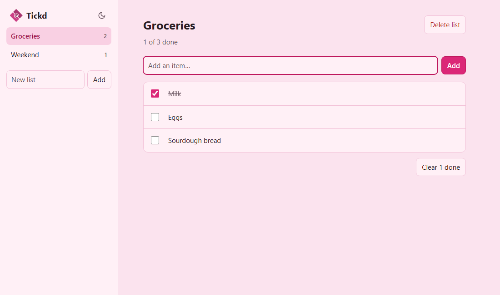
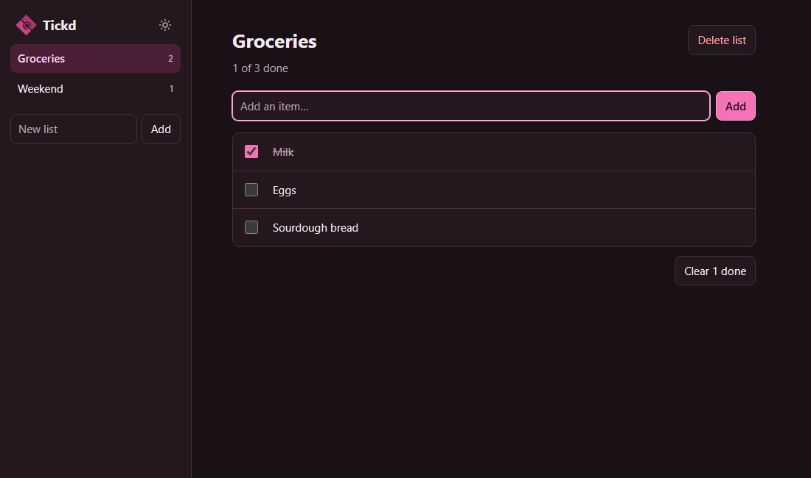

<div align="center">


# Tickd

A simple, fast list-keeping app in a single HTML file.


</div>





## Overview

Tickd lets you keep as many lists as you like — groceries, to-dos, packing, reading — and tick items off as you go. Everything is saved in your browser automatically, so your lists are still there next time you open the page. There is nothing to install and no server.

## Features

- **Multiple lists** — create, switch between, rename and delete lists from the sidebar.
- **Items** — add, tick off, edit in place and delete items.
- **Progress at a glance** — each list shows how many items are left; the open list shows "x of y done".
- **Clear done** — remove every ticked item in one click.
- **Saves automatically** — stored in the browser's `localStorage`; no account or backend.
- **Keyboard friendly** — press Enter to add an item or finish editing; focus stays where you are after each action.
- **Safe with two tabs open** — a change in one tab shows up in the other instead of being overwritten.
- **Works on phones** — the layout stacks on narrow screens.
- **Light and dark themes** — follows your device; the sun/moon button in the sidebar overrides it and remembers your choice (pick your device's theme again to go back to following it).

## Tech stack

| Layer | Choice |
| --- | --- |
| Markup | HTML5 |
| Styling | Plain CSS (custom properties, grid); dark theme via `:root[data-theme="dark"]` |
| Logic | Vanilla JavaScript, no dependencies |
| Storage | Browser `localStorage` (keys `lists-app:v1` for lists, `lists-app:theme` for a chosen theme) |

## Project structure

```
lists/
├── index.html       # the whole app: markup, styles and script
├── logo.png         # app logo and browser-tab icon
├── screenshot.png       # used in this README (light)
├── screenshot-dark.png  # used in this README (dark)
└── README.md
```

The script keeps one `state` object (`{ lists, activeId }`), and every change runs `update()`, which saves to `localStorage` and redraws the sidebar and the open list. All user text is inserted with `textContent`, never as HTML.

## Getting started

### Prerequisites

Any modern browser (Chrome, Edge, Firefox, Safari).

### Run

Open `index.html` in your browser — double-click it, or:

```bash
start index.html      # Windows
open index.html       # macOS
```

There is no install, environment setup or build step. To host it, upload `index.html` to any static host.

### Data

Lists are stored per browser. Clearing your browser's site data removes them.
